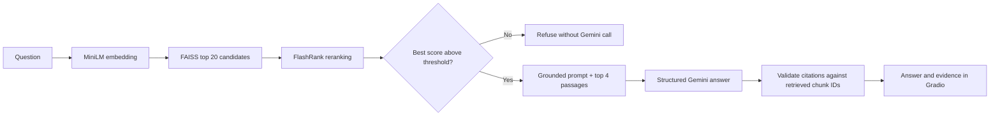

# The Prince RAG

A local **Retrieval-Augmented Generation (RAG)** application for asking questions about Niccolò Machiavelli's *The Prince*. The application retrieves relevant passages from the book, reranks them, passes them to a Gemini model as restricted context, and displays an answer with citations to the source passages.

This project was developed as part of the AI Bootcamp organized by Srpska IT Asocijacija.

The project also includes simpler educational profiles that demonstrate lexical search, chunking strategies, refusal-threshold calibration, and RAG answer evaluation.

> **Corpus language:** the included edition is in English (translated by W. K. Marriott). For best results, ask questions in English. The interface has Serbian labels, but the source text has not been translated into Serbian.

## Contents

- [Features](#features)
- [How it works](#how-it-works)
- [Architecture and technologies](#architecture-and-technologies)
- [Project structure](#project-structure)
- [Installation](#installation)
- [Run the web application](#run-the-web-application)
- [Use the command line](#use-the-command-line)
- [Refusals and citations](#refusals-and-citations)
- [Evaluation and results so far](#evaluation-and-results-so-far)
- [Tests and evidence generation](#tests-and-evidence-generation)
- [Configuration and limitations](#configuration-and-limitations)
- [Corpus source](#corpus-source)

## Features

- Gradio web interface for asking repeated questions about the book.
- Parses the Project Gutenberg edition and extracts the dedication and Chapters I–XXVI; the introduction and appendix are not indexed as part of the main corpus.
- Chunks the text with overlap and chapter metadata.
- Performs semantic search using a local Sentence Transformers model and a FAISS vector index.
- Further reranks candidates with FlashRank.
- Generates concise answers with Gemini, instructing it to use only the retrieved text.
- Adds citations to individual claims, restricts them to IDs of retrieved chunks, and validates them before displaying the answer.
- Refuses questions when the best reranker score does not reach the calibrated threshold.
- Includes a CLI and educational profiles for basic lexical search.
- Implements four reference-backed RAGAS metrics and stores per-question results with the retrieved context.
- Includes chunking and retriever comparisons in `evidence.md`.

## How it works



For the Prince profile, a question is processed as follows:

1. `src/corpus.py` reads the text and checks the expected chapter structure. Footnotes and their inline markers are removed from chapter text.
2. `src/chunking.py` splits each chapter separately while preserving chunk IDs and chapter metadata. The default configuration uses 800 characters with 120 characters of overlap.
3. `src/embeddings.py` encodes the text with the local `sentence-transformers/all-MiniLM-L6-v2` model.
4. `src/vector_store.py` normalizes the vectors and uses FAISS `IndexFlatIP`; the dot product of normalized vectors is equivalent to cosine similarity. The index, chunks, and manifest are stored in `.cache/prince-faiss/`. The manifest checks whether the corpus, chunk parameters, and embedding model match the saved index.
5. `src/reranking.py` takes up to 20 FAISS candidates and reranks them with FlashRank's `ms-marco-TinyBERT-L-2-v2` model. By default, the top four are passed to the next step.
6. `src/pipeline.py` compares the best reranking score with the threshold in `data/refusal_calibration_scores.json`. If the score is below the threshold, the pipeline refuses the question without calling Gemini.
7. `src/generation.py` builds a prompt containing the retrieved passages and requests a Gemini JSON response with individual claims and citations. The JSON schema restricts allowed IDs; `src/pipeline.py` also rejects missing or invalid citations.
8. `app.py` displays the answer and relevant passages. If the question is refused or the answer is recognized as saying the evidence is insufficient, the passages are hidden so they do not appear to support the answer.

These safeguards reduce the risk of unsupported answers. They are not a mathematical guarantee that the model will never make a mistake.

## Architecture and technologies

| Component | Technology | Role |
|---|---|---|
| Web UI | Gradio 6 | Local interface for questions, answers, and evidence |
| LLM generation | Google GenAI SDK, Gemini | Answers grounded in the supplied context |
| Embeddings | Sentence Transformers, `all-MiniLM-L6-v2` | Locally converts questions and chunks into vectors |
| Vector index | FAISS CPU (`IndexFlatIP`) | Fast ranking of embedding candidates |
| Reranking | FlashRank, `ms-marco-TinyBERT-L-2-v2` | Reranks FAISS candidates against the question |
| Evaluation | RAGAS 0.4.3 | LLM- and embedding-based evaluation of four RAGAS metrics |
| RAGAS Gemini adapter | OpenAI async client to Gemini's OpenAI-compatible endpoint | Evaluator; separate from the main Gemini generation adapter |
| Testing | pytest | Unit and integration tests for components and pipeline |

Corpus extraction, chunking, embeddings, indexing, retrieval, reranking, generation, orchestration, and evaluation are organized in separate modules. The CLI and Gradio app use the same Prince pipeline configured in `src/cli.py`.

## Project structure

```text
.
├── app.py                         # Gradio web application
├── data/
│   ├── book.txt                   # Project Gutenberg source text
│   ├── ragas_eval.json            # Reference questions and answers for evaluation
│   ├── refusal_calibration.json   # Labeled supported/unsupported questions
│   └── refusal_calibration_scores.json # Measured scores and refusal threshold
├── docs/
│   ├── homework-checklist.md      # Task status
│   └── progress-log.md            # Work log and results
├── evidence.md                    # Sample outputs and methodological comparisons
├── evidence/
│   └── ragas-metrics.json         # Per-question results and mean metrics
├── scripts/
│   ├── compare_retrievers.py      # Multi-vector and parent retrieval comparison
│   ├── evaluate_ragas.py          # RAGAS evaluation
│   ├── generate_evidence.py       # Regenerates demonstration outputs
│   └── run_tests.sh               # Runs the test suite
├── src/
│   ├── chunking.py                # Chunking and overlap strategies
│   ├── cli.py                     # Pipeline configuration and command line
│   ├── corpus.py                  # Source loading and cleaning
│   ├── embeddings.py              # Embedding interface and local model
│   ├── evaluation.py              # RAGAS metrics and scoring
│   ├── generation.py              # Gemini adapter, prompt, and citation validation
│   ├── pipeline.py                # Prince RAG orchestration
│   ├── rag.py                     # Simple educational lexical RAG
│   ├── reranking.py               # FlashRank and threshold calibration
│   ├── retrieval.py               # Simple lexical search
│   └── vector_store.py            # FAISS index and manifest
└── tests/                         # Module and pipeline tests
```

## Installation

Python 3.12 and `pip` are required. From the repository root, run:

```bash
python3.12 -m venv .venv
source .venv/bin/activate
python -m pip install --upgrade pip
pip install -r requirements.txt
```

On Windows PowerShell:

```powershell
py -3.12 -m venv .venv
.venv\Scripts\Activate.ps1
python -m pip install --upgrade pip
pip install -r requirements.txt
```

On first use, the local embedding and reranker models are downloaded if they are not already cached. The Prince index is built automatically on first launch and stored in `.cache/`. A Gemini API key is required to generate answers.

### Gemini API key

Create a `.env` file in the repository root:

```dotenv
GEMINI_API_KEY=your_api_key
# Optional; defaults to gemini-3.1-flash-lite
GEMINI_MODEL=gemini-3.1-flash-lite
```

`.env` is listed in `.gitignore`. **Never commit your API key** or include it in the README, evidence files, or public issues. The application uses `python-dotenv` to load the local `.env`; existing environment variables take precedence.

## Run the web application

From the repository root:

```bash
source .venv/bin/activate
python app.py
```

Then open the address printed by Gradio, by default `http://127.0.0.1:7860`. The app listens only on `127.0.0.1` and does not create a public share link. The interface supports repeated questions; the local Gradio queue has no preset maximum number of waiting requests. Successful Gemini generations are still subject to the API account's quota, availability, and terms.

Without a valid Gemini key, retrieval and evidence display may work, but answer generation will fail. The interface displays the generation error.

## Use the command line

### Prince pipeline

Example of a supported question:

```bash
python -m src.cli \
  --corpus-profile prince \
  --question "What does Chapter II say about hereditary principalities and change?" \
  --top-k 4
```

Example of a question for which the corpus does not contain enough evidence:

```bash
python -m src.cli \
  --corpus-profile prince \
  --question "What names of parents were given for Castruccio Castracani, and how was the child raised?" \
  --top-k 4
```

Important CLI options:

| Option | Default | Meaning |
|---|---:|---|
| `--candidate-n` | `20` | Number of FAISS candidates sent to the reranker |
| `--top-k` | `2` CLI / `4` in Gradio | Number of final results after reranking |
| `--book-chunk-size` | `800` | Target Prince chunk size in characters |
| `--book-overlap` | `120` | Overlap between neighboring chunks |
| `--refusal-threshold` | Calibrated report | Manually set the refusal threshold |
| `--index-dir` | `.cache/prince-faiss` | FAISS index directory |
| `--reranker-cache-dir` | `.cache/flashrank` | Local FlashRank model directory |

### Educational lexical profiles

The CLI without the `prince` profile uses a small demonstration corpus and lexical retrieval:

```bash
python -m src.cli --question "What is retrieval augmented generation?"
python -m src.cli --question "Who won the world cup in 1958?"
python -m src.cli --corpus-profile training-rag \
  --question "Why are citations important in RAG?"
```

Available profiles are `default`, `training-rag`, and `prince`. The first two are simpler examples for demonstrating lexical retrieval; they do not use the full FAISS/FlashRank/Gemini flow.

## Refusals and citations

The Prince pipeline uses the threshold in `data/refusal_calibration_scores.json`, currently `0.48179012`. It was selected from eight labeled questions (four supported and four unsupported) using a balanced accuracy criterion. On this calibration set, the result was 4 true positives, 4 true negatives, 0 false positives, and 0 false negatives.

This small calibration set is used to choose an operational threshold, not to independently estimate general accuracy. Results may differ on new questions. When there is not enough relevant evidence, the pipeline refuses before calling the LLM. For generated answers, citations are validated against retrieved chunk IDs; invalid citations prevent the answer from being treated as successful.

Gemini is instructed to use only the supplied passages and cite each factual claim. This reduces the risk of hallucination, but generative models can still misinterpret context, so review the cited passages.

## Evaluation and results so far

The latest saved RAGAS report is `evidence/ragas-metrics.json`. It was generated on October 12, 2026, with RAGAS 0.4.3 using four manually prepared supported questions. All four answers passed citation validation and were scored:

| Metric | Latest mean |
|---|---:|
| Faithfulness | 1.0000 |
| Answer Relevancy | 0.7718 |
| Context Precision | 0.8750 |
| Context Recall | 1.0000 |

An earlier report scored 2 of 4 cases: Faithfulness 0.9167, Answer Relevancy 0.7631, Context Precision 0.7500, and Context Recall 1.0000. The other two cases were not scored because their citations referred to chunks outside the retrieved set. A later attempt generated answers for all four questions, but evaluation calls stopped after Gemini returned HTTP 429; that attempt was not treated as a new RAGAS result.

Context Precision increased from 0.7500 to 0.8750 in the saved results, while Context Recall remained 1.0000. However, the number of scored cases changed from two to four, and no controlled before/after experiment was run with identical settings. The difference therefore cannot be attributed to the reranker alone. `evidence.md` also contains an example where FlashRank ranks directly relevant Chapter II ahead of the less directly relevant Chapters I and III.

RAGAS metrics are estimates from an evaluation model, not deterministic guarantees. Gemini is used for Faithfulness and Context metrics; Answer Relevancy uses local MiniLM embeddings. The report contains individual answers, references, contexts, citations, and scores.

### Chunking and retrieval experiments

`scripts/generate_evidence.py` compares three chunking strategies on the same Chapter XV example: the initial fixed-size chunker at 140/30, word-boundary chunking at 800/120, and sentence-aware chunking at 800/120. The comparison inspects actual retrieved passages and provides a qualitative assessment; it is not a labeled retrieval benchmark, and scores across different chunk lengths are not directly comparable.

`scripts/compare_retrievers.py` compares multi-vector retrieval (returns the directly matching smaller child chunks) with parent retrieval (groups a hit and returns a wider parent window of about 1,600 characters). The experiment holds the corpus, child index, embedding model, and FlashRank ranking constant. It demonstrates the trade-off between a more precise passage and broader context. It is a demonstration on a selected query, not a general benchmark.

## Tests and evidence generation

Run the tests with:

```bash
python -m pytest -q
```

The latest documented test snapshot in `evidence.md` is `49 passed`. Five successful manual live checks were also reported during development. Since their individual scenarios and outputs were not saved, this count is not presented as an independently reproduced benchmark.

Regenerate demonstration CLI output and comparisons without Gemini calls:

```bash
HF_HUB_OFFLINE=1 TRANSFORMERS_OFFLINE=1 \
  python scripts/generate_evidence.py --offline
```

By default, the script removes `GEMINI_API_KEY` from its CLI child processes. Add `--allow-gemini` only if you want the script to load `.env` and make a real Gemini generation call. The script also runs the test suite to capture its output in `evidence.md`.

Compare multi-vector and parent retrieval:

```bash
HF_HUB_OFFLINE=1 TRANSFORMERS_OFFLINE=1 \
  python scripts/compare_retrievers.py --offline
```

### RAGAS evaluation

Evaluation makes real Gemini calls for answer generation and LLM-as-a-judge scoring. It may consume API quota and updates `evidence/ragas-metrics.json`:

```bash
python scripts/evaluate_ragas.py
```

Optionally limit evaluation to the first case or use a different evaluator model:

```bash
python scripts/evaluate_ragas.py --limit 1
```

```dotenv
RAGAS_EVAL_MODEL=gemini-3.1-flash-lite
```

`RAGAS_EVAL_MODEL` defaults to `GEMINI_MODEL`, then `gemini-3.1-flash-lite`. A valid `GEMINI_API_KEY` is required for answer generation and RAGAS LLM evaluation.

## Configuration and limitations

- The Gemini API may enforce quotas, rate limits, billing, or temporarily reject requests. The application cannot remove account-level limits; errors such as HTTP 429 must be addressed through the available quota, model, or account, or by waiting for the limit to reset.
- The local maximum number of requests in the Gradio queue has been removed, but this does not mean Gemini API calls are unlimited.
- The local FAISS and FlashRank caches are excluded from Git. If the text, model, or chunking parameters change, the manifest detects a stale index and the pipeline rebuilds it.
- The first launch may require network access to download models. After caching, embeddings, vector search, and reranking run locally; Gemini generation and RAGAS LLM evaluation require network access.
- The available corpus is limited to the dedication and Chapters I–XXVI in the included English edition. Questions about the omitted introduction, footnotes, or appendix should be refused.
- The refusal threshold was calibrated on a small internal set; a larger set and separate held-out benchmark are needed for a more reliable evaluation.

## Corpus source

`data/book.txt` contains *The Prince* by Niccolò Machiavelli, translated by W. K. Marriott, from Project Gutenberg eBook #1232. The text file includes the Project Gutenberg license and advises users to check local laws regarding use. [Project Gutenberg — The Prince, eBook #1232](https://www.gutenberg.org/ebooks/1232).
